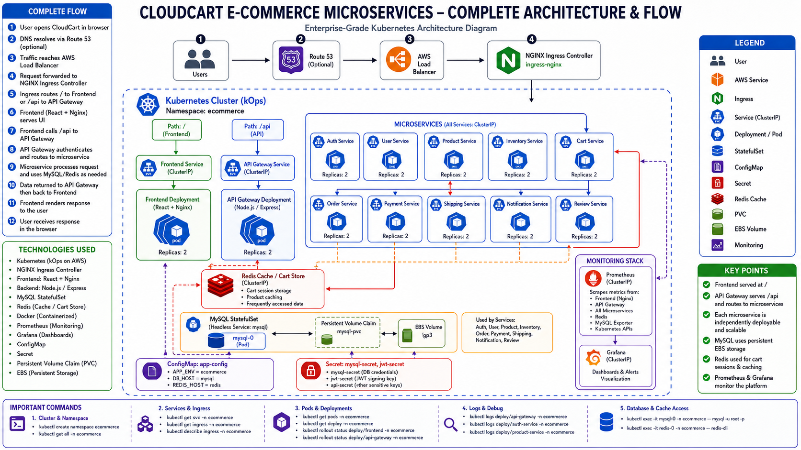
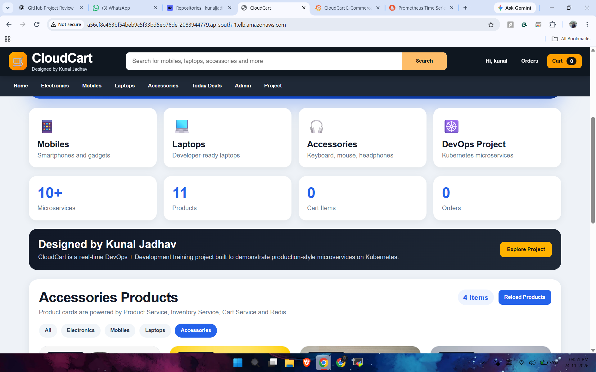
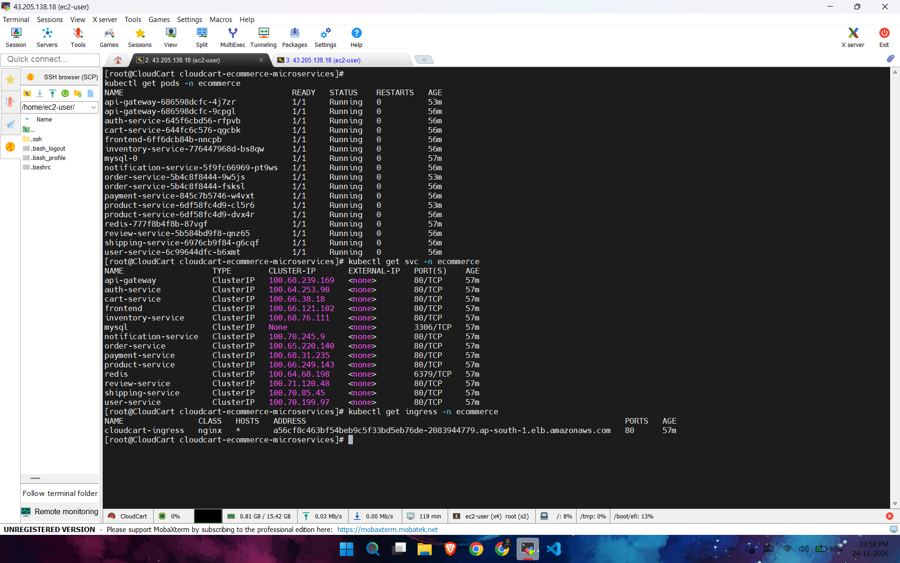
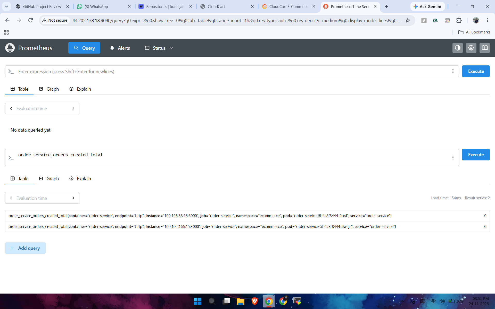
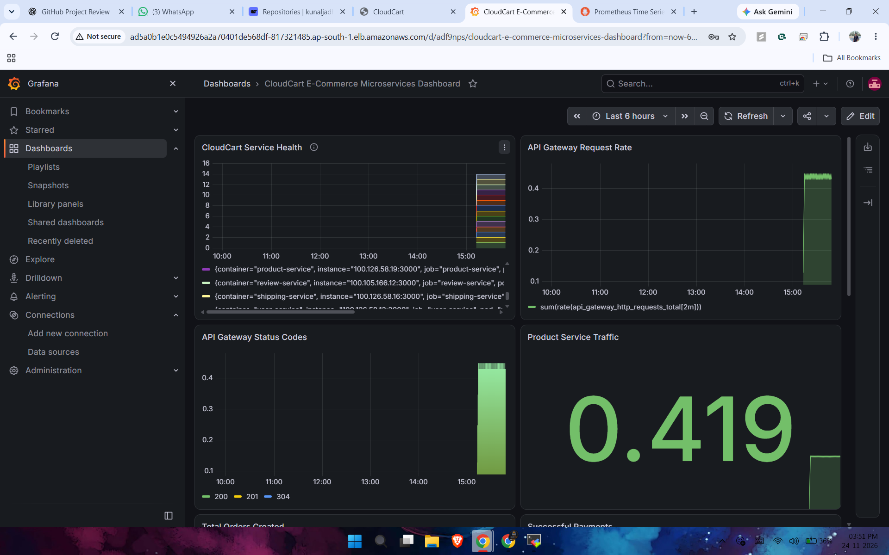

<div align="center">

# CloudCart
### E-Commerce Microservices on Kubernetes

An end-to-end cloud-native project that generates a React storefront and a set of independently containerized Node.js services, then deploys them to Kubernetes with MySQL, Redis, ingress, and optional Prometheus/Grafana monitoring.

<p>
  
  
  
  
  
</p>

[Architecture](#architecture) · [Features](#features) · [Quick start](#quick-start) · [Deployment](#deploy-to-kubernetes) · [Screenshots](#screenshots)

</div>

---

## About

CloudCart is a full-stack e-commerce demonstration and DevOps learning project. It illustrates how a browser-facing React application can use an API gateway to communicate with small backend services, with Kubernetes handling service discovery, health checks, and workload deployment.

The repository contains a **project generator and deployment automation** rather than the generated application source itself. Running [`create_cloudcart_fixed.sh`](create_cloudcart_fixed.sh) creates the application, Dockerfiles, Kubernetes manifests, and helper scripts in a separate `cloudcart-ecommerce-microservices` directory.

> **Scope:** This is a learning/demo project, not a production-ready commerce platform. Payment processing is simulated; review security, availability, persistence, and operational requirements before using it with real users or data.

## Architecture



**Request flow:** Browser → AWS Load Balancer → NGINX Ingress → React frontend or `/api` API Gateway → backend services → MySQL and/or Redis.

| Component | Responsibility |
| --- | --- |
| React frontend (served by NGINX) | Product browsing, search, categories, accounts, cart, checkout, orders, reviews, and admin product entry |
| API Gateway | Routes frontend `/api` requests to the appropriate internal service |
| Auth Service | Registration and login |
| User Service | User profile data |
| Product Service | Product catalog and product creation |
| Inventory Service | Stock lookup and updates |
| Cart Service | Cart operations backed by Redis |
| Order Service | Order creation and coordination with inventory, payment, shipping, and notification services |
| Payment Service | Demonstration payment flow; not a real payment processor |
| Shipping Service | Shipment and tracking records |
| Notification Service | Order-related notifications |
| Review Service | Product reviews |
| MySQL | Relational service data; deployed as a StatefulSet with persistent storage |
| Redis | Cart data and product caching |
| Prometheus / Grafana | Optional metrics collection and dashboards |

The generator creates **11 backend containers** (the API Gateway plus 10 domain services) and one frontend container. It configures Kubernetes Deployments and Services, a MySQL StatefulSet and PVC, ConfigMaps, a Secret, readiness/liveness probes, resource requests/limits, and an NGINX Ingress resource. Prometheus integration is optional and requires a Prometheus Operator installation.

## Features

- E-commerce interface with category filtering, product search, product details, and seeded sample catalog
- Account registration/login, cart management, order placement, stock checking, reviews, and notifications
- Admin product creation with inventory initialization
- Independent Node.js/Express service containers and a multi-stage React/NGINX frontend image
- MySQL schemas for application domains and Redis-backed cart/cache operations
- Kubernetes health probes, resource controls, persistent database storage, and ingress routing
- Service `/metrics` endpoints and an optional ServiceMonitor for Prometheus
- Separate helpers to generate the project, build/push images, deploy resources, and inspect deployments

## Technology stack

| Area | Technologies |
| --- | --- |
| Frontend | React, NGINX |
| Backend | Node.js 20, Express.js |
| Data | MySQL 8, Redis 7 |
| Containers | Docker |
| Orchestration | Kubernetes, kOps |
| Cloud / entry point | AWS, NGINX Ingress Controller, AWS Load Balancer |
| Observability | Prometheus, Prometheus Operator, Grafana |

## Repository contents

```text
.
├── README.md
├── architecture.png
├── create_cloudcart_fixed.sh   # Generates the application and its deployment files
├── kops.sh                     # Creates or deletes the configured AWS kOps cluster
├── microservices-project-new.txt # Detailed project and deployment notes
└── Screenshoots/
    ├── Application-UI.png
    ├── Application-load-balancer.png
    ├── Grafana-dashboard.png
    ├── prometheus.png
    ├── cluster-nodes.png
    ├── ec2-instances.png
    ├── s3-bucket.png
    └── docker-hub-images.png
```

The generated application directory is not checked in; it is created when you run the generator.

## Quick start

### Prerequisites

- A Linux shell with Bash, `curl`, `wget`, and Python 3
- Docker and a Docker Hub account (or another registry you configure)
- An AWS account and configured AWS CLI credentials with permissions for the resources created by kOps
- `kubectl`, kOps, and Helm for cluster and Kubernetes operations

The `kops.sh` script attempts to install `kubectl` and kOps if they are missing, but it expects AWS CLI access and suitable system permissions. Review its hard-coded cluster, region, availability zones, AMI, instance sizes, and S3 state bucket before running it.

### 1. Generate the application

> **Important:** The generator begins with `rm -rf "$PROJECT"`. It deletes the directory named by `PROJECT` before generating files. Set `PROJECT` to a new, disposable path and make sure it does not contain data you need.

From the repository root:

```bash
export PROJECT=cloudcart-ecommerce-microservices
export DOCKER_USER=your-dockerhub-username
export IMAGE_TAG=v1
export MYSQL_ROOT_PASSWORD='replace-with-a-strong-unique-password'
export JWT_SECRET='replace-with-a-long-random-secret'

bash create_cloudcart_fixed.sh
cd "$PROJECT"
```

The generated Kubernetes Secret manifest contains the configured credentials. Treat generated manifests as sensitive: do not commit them or publish them in logs. The generator has development defaults for secrets, so set your own values before generating the project.

### 2. Build and push container images

Log in to your image registry, then build and push the 11 backend images and the frontend image:

```bash
docker login
./scripts/build-push.sh
```

The script uses `DOCKER_USER` and `IMAGE_TAG` from the environment. Ensure the Kubernetes cluster can pull the published images.

## Deploy to Kubernetes

### Provision a kOps cluster on AWS (optional)

If you do not already have a cluster, open a shell at the **repository root**, inspect and customize the values in `kops.sh`, then run it from a suitable Linux/AWS environment:

```bash
bash kops.sh create
```

The script creates an S3 state bucket and provisions an AWS cluster (control plane, worker nodes, networking, and related resources). This can incur AWS charges. Confirm the account, region, instance sizes, bucket name, and expected costs before proceeding.

### Install NGINX Ingress and deploy CloudCart

Configure `kubectl` to use your target cluster, then install the ingress controller:

```bash
helm repo add ingress-nginx https://kubernetes.github.io/ingress-nginx
helm repo update
helm upgrade --install ingress-nginx ingress-nginx/ingress-nginx \
  --namespace ingress-nginx \
  --create-namespace
```

Apply the generated application resources:

```bash
./scripts/deploy.sh
kubectl get pods,svc,ingress -n ecommerce
```

Run these commands from the generated application directory created in the quick-start step.

The deployment script applies MySQL, Redis, backend services, the frontend, and the Ingress. After the ingress controller provisions its AWS load balancer, retrieve the application address with:

```bash
kubectl get ingress -n ecommerce
kubectl get svc -n ingress-nginx ingress-nginx-controller
```

Open the Ingress address in a browser. The Ingress routes `/` to the frontend and `/api` to the API Gateway.

### Optional: Prometheus and Grafana

Install the Prometheus Operator stack if it is not already available in the cluster:

```bash
helm repo add prometheus-community https://prometheus-community.github.io/helm-charts
helm repo update
helm upgrade --install kube-prometheus-stack \
  prometheus-community/kube-prometheus-stack \
  --namespace monitoring \
  --create-namespace \
  --set prometheus.prometheusSpec.serviceMonitorSelectorNilUsesHelmValues=false \
  --set prometheus.prometheusSpec.serviceMonitorNamespaceSelector.any=true
```

After CloudCart is deployed, apply its ServiceMonitor:

```bash
kubectl apply -f k8s/monitoring-optional.yaml
kubectl get servicemonitor -n ecommerce
kubectl get pods,svc -n monitoring
```

The ServiceMonitor selects labeled CloudCart services and scrapes their `/metrics` endpoints. Access Grafana through the service created by the Helm chart, or use `kubectl port-forward` rather than exposing monitoring publicly.

## Verification and troubleshooting

```bash
kubectl get pods -n ecommerce
kubectl get services,endpoints -n ecommerce
kubectl get ingress -n ecommerce
kubectl logs -n ecommerce deploy/api-gateway --tail=100
kubectl logs -n ecommerce deploy/product-service --tail=100
```

The generated helper `./scripts/verify.sh` checks pods/endpoints and prints recent API Gateway logs; it also deletes the Redis `products:list` cache key. Use it only if clearing that cache is acceptable.

Common checks:

- **Pods not ready:** inspect `kubectl describe pod` and the relevant deployment logs; confirm the database and Redis are ready.
- **Image pull errors:** verify `DOCKER_USER`, `IMAGE_TAG`, image visibility, and cluster registry credentials.
- **Ingress address missing:** check the ingress controller pods/services and AWS load balancer provisioning events.
- **No Prometheus targets:** confirm the Prometheus Operator is installed, the ServiceMonitor is selected, and services expose `/metrics`.

## AWS cleanup and cost warning

The cluster helper's delete operation is destructive:

```bash
bash kops.sh delete
```

It asks for the exact confirmation `DELETE`, then removes the Kubernetes cluster and attempts to delete **all objects, versions, and delete markers** in the configured kOps S3 state bucket before deleting the bucket. Do not run this against a shared or important AWS account/bucket. Verify the configured values and make backups first. Also review AWS for any remaining billable resources after cleanup.

## Screenshots

### Application



### Kubernetes and monitoring

<p align="center">
  
  
  
</p>

More deployment evidence is available in [`Screenshoots/`](Screenshoots/), including AWS load balancers, EC2 instances, S3 state storage, and published Docker images. Screenshots are examples and may not reflect a currently running deployment.

## Project notes

See [`microservices-project-new.txt`](microservices-project-new.txt) for extended walkthrough notes, example API calls, monitoring queries, and manual Kubernetes operations.

---

<div align="center">
Built as a hands-on full-stack, Kubernetes, and cloud operations project.
</div>
